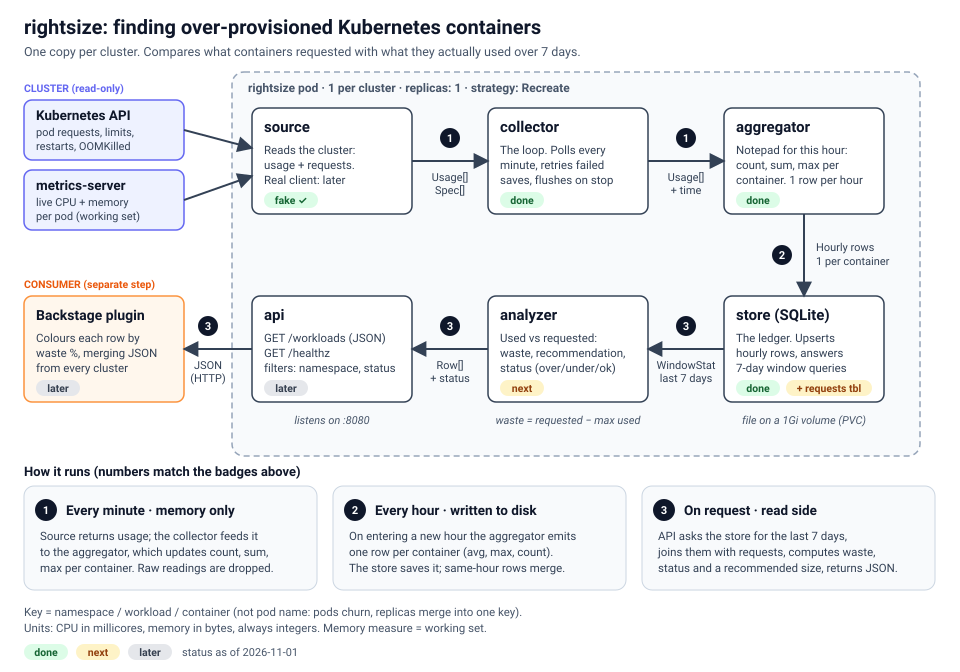

# rightsize: architecture

> Status as of 2026-11-01: source (fake), aggregator, store, collector are built and tested.
> Next: requests half of the data, analyzer, API, real Kubernetes source, deploy, Backstage view.

## 1. The problem

Kubernetes schedules a pod using what the pod **requests**, not what it actually **uses**.
If a container requests 2 GiB of memory and uses 400 MiB, the node still holds the full
2 GiB for it. When enough containers over-request, new pods fail with
`0/N nodes are available: insufficient memory`, even though the cluster looks mostly idle.
Teams then "fix" it by lowering requests and limits by guesswork until the deploy goes through.

The usual tool for seeing real usage over time (Prometheus plus Grafana) was removed from
these clusters because it used too much disk. We still need to answer:

> **Which containers request far more CPU or memory than they use, and how much could be reclaimed?**

## 2. What we build

A small Go service, **one copy per cluster**. It:

1. samples live usage every minute from the Kubernetes metrics API,
2. squashes the samples into one summary row per container per hour (average and max),
3. keeps about two weeks of those rows in a SQLite file,
4. compares the last 7 days of usage with what each container requested, and
5. serves the result as JSON (waste, a recommended size, and a status) for a UI to colour.

Non-goals for v1: percentiles (p95), automatic changes to manifests, a view across clusters
inside the service (a UI merges the per-cluster JSON), replacing Prometheus in general.



## 3. Words used in this document

| Term | Meaning |
|---|---|
| request | Resources a container reserves. The scheduler uses this. CPU in cores/millicores, memory in bytes. |
| limit | Hard cap. CPU is throttled above it; memory above it gets the container OOMKilled. |
| usage | What the container is really using right now (from metrics-server). |
| working set | The memory measure metrics-server reports and the OOM killer cares about. Use this, not total RSS. |
| OOMKilled | The container was killed for exceeding its memory limit. Visible in the pod status. |
| workload | The thing that owns pods: a Deployment, StatefulSet, DaemonSet, Job. Pods are replaceable; workloads are stable. |
| Key | `namespace / workload / container`. Identifies one container across time. |
| window | The period compared against requests (default 7 days). |
| waste | `request - max usage over the window` (never below 0). |

## 4. How data moves

```
Usage (per minute)  ->  Hourly (per hour)  ->  WindowStat (per request)  ->  Row (per request)  ->  JSON
   source/collector      aggregator -> store        store                      analyzer                api
```

All numbers are **int64 in the smallest unit**: CPU in millicores, memory in bytes.
Floating point is used only for averages.

```go
// model
type Key struct{ Namespace, Workload, Container string }

type Usage struct { // one reading
    Key      Key
    CPUMilli int64
    MemBytes int64 // working set
}

type Spec struct { // what the container asked for, plus trouble signs (NOT BUILT YET)
    Key             Key
    CPURequestMilli int64
    MemRequestBytes int64
    CPULimitMilli   int64
    MemLimitBytes   int64
    Restarts        int64
    LastOOM         time.Time // zero value = never
}

// aggregator
type Hourly struct { // one row: one container, one UTC hour
    Hour    time.Time // start of the hour, UTC
    Key     model.Key
    Samples int64     // how many readings went in
    CPUAvg  float64
    CPUMax  int64
    MemAvg  float64
    MemMax  int64
}

// store
type WindowStat struct { // one container summarised over the window
    Key         model.Key
    HoursOfData int
    CPUAvg      float64
    CPUMax      int64
    MemAvg      float64
    MemMax      int64
}
```

## 5. Components

Each package has one job and knows as little as possible about the others.

### 5.1 `source` (fake built, real not built)
Answers: "what is used and requested right now?"

```go
type Source interface {
    Usage(ctx context.Context) ([]model.Usage, error) // exists today
    // Specs / Snapshot: added in the next step, see "Open decisions"
}
```
- `Fake`: made-up workloads with ~±10% noise and occasional spikes. Used for tests and demos.
- `Kube` (later): see section 8.

### 5.2 `aggregator` (built)
A pure data structure. No clock, no disk, no goroutines, so it is trivial to test.
- `Add(now, usages) []Hourly`: folds readings into running totals. If `now` has entered a later UTC hour than the one being accumulated, it first returns the finished hour (and resets).
- `Flush() []Hourly`: returns the hour in progress and resets (used on shutdown).
- `Merge(a, b Hourly) Hourly`: combines two pieces of the same hour (see algorithm in 6.1).

### 5.3 `store` (built; requests table not yet)
SQLite through the pure-Go driver `modernc.org/sqlite` (no cgo, one static binary).
- `Open(path)`: creates the schema, sets `SetMaxOpenConns(1)` (SQLite has one writer).
- `SaveHourly(ctx, []Hourly)`: one transaction; upsert that merges rows for the same hour and key.
- `Window(ctx, since) []WindowStat`: the 7-day query (6.2).
- `Prune(ctx, before)`: deletes rows with `hour < before`.

### 5.4 `collector` (built)
The loop that connects source, aggregator and store.
- Ticker every `interval` (default 1 min); first poll happens immediately.
- Read fails: log and skip that tick. One bad poll must not stop the service.
- Finished hours go into `pending`; saving `pending` is retried every poll until it succeeds.
- On context cancel (SIGTERM): flush the partial hour and save with a **fresh** 10-second context (the cancelled one would fail instantly).
- All collector state is touched by one goroutine only, so it needs no locks.

### 5.5 `analyzer` (next)
Pure function: `WindowStat` plus requests plus config in, `Row` out. See 6.3.

### 5.6 `api` (later)
`net/http`, JSON. See section 7.

## 6. Algorithms

### 6.1 Hourly aggregation (the key idea)
We only need an average and a max, so we never store raw readings. Per container we keep
three running numbers for the current hour: **count, sum, max**.

```
bucket = floor_to_hour(now in UTC)
if bucket is later than the current hour:
    emit one Hourly per key: avg = sum / count, max = max
    reset all totals
for each reading:
    count += 1;  sum += value;  max = max(max, value)
```
- Memory used is `O(containers)`, not `O(readings)`.
- Averages cannot be averaged. To merge two pieces of one hour (after a restart),
  weight by sample count: `avg = (avgA*nA + avgB*nB) / (nA+nB)`; `max = max(maxA, maxB)`; `n = nA+nB`.
- Replicas of one workload share a Key. Their readings all fold into the same totals, so
  `avg` is the typical usage of **one replica** and `max` is the highest any replica reached.
  That is the right quantity for sizing a per-pod request.
- Percentiles (p95) are deliberately not in v1: they cannot be merged from small state;
  they need all readings or an approximate sketch.

### 6.2 Window query (7 days)
Same idea again, one level up: combine hourly rows with weights.

```sql
SELECT namespace, workload, container,
       COUNT(*)                              AS hours_of_data,
       SUM(cpu_avg * samples) / SUM(samples) AS cpu_avg,
       MAX(cpu_max)                          AS cpu_max,
       SUM(mem_avg * samples) / SUM(samples) AS mem_avg,
       MAX(mem_max)                          AS mem_max
FROM usage_hourly
WHERE hour >= :since
GROUP BY namespace, workload, container;
```
`COUNT(*)` counts hours only while each (hour, key) has exactly one row, which the upsert guarantees.

### 6.3 Waste, recommendation, status
```
memWaste     = max(0, memRequest - memMax)        (same for CPU, using cpuMax)
memWastePct  = memWaste / memRequest * 100        (0 if request is 0)
recommended  = ceil(max * (1 + margin))           rounded UP to 1 MiB (memory) / 10m (CPU)
```
We use **max, not average**, so we never recommend going below a peak the container really hit.

Status, first match wins:

| # | Status | Condition | Recommendation |
|---|---|---|---|
| 1 | `do-not-shrink` | OOMKilled within the last 7 days | keep current request; a human must look |
| 2 | `insufficient-data` | `hours_of_data < min_hours` (24) | none |
| 3 | `no-request` | no CPU and no memory request set | max * (1 + margin) |
| 4 | `under-provisioned` | `memMax > memRequest` | max * (1 + margin) |
| 5 | `over-provisioned` | memory or CPU waste % at least 30 | max * (1 + margin) |
| 6 | `ok` | otherwise | max * (1 + margin) |

CPU above its request is normal bursting, so only **memory** can make a container under-provisioned.

## 7. HTTP API

`GET /workloads?namespace=<ns>&status=<status>` returns, sorted by `mem_waste_bytes` descending:

```json
{
  "cluster": "dev-1",
  "generated_at": "2026-11-01T10:00:00Z",
  "window_hours": 168,
  "workloads": [{
    "namespace": "payments", "workload": "payments-api", "container": "app",
    "status": "over-provisioned", "hours_of_data": 168, "restarts": 0,
    "mem_request_bytes": 2147483648, "mem_avg_bytes": 0, "mem_max_bytes": 0,
    "mem_waste_bytes": 0, "mem_waste_pct": 0, "mem_recommended_bytes": 0,
    "cpu_request_millicores": 1000, "cpu_avg_millicores": 0, "cpu_max_millicores": 0,
    "cpu_waste_millicores": 0, "cpu_waste_pct": 0, "cpu_recommended_millicores": 0
  }]
}
```
`GET /healthz` returns 200 `ok`. It should start failing if saves have been failing for a
sustained period (policy in section 10).

## 8. Real Kubernetes source (not built)

- List pods (`GET /api/v1/pods`, paginated with `limit` and `continue`). Skip phases `Succeeded` and `Failed`.
- Read metrics (`GET /apis/metrics.k8s.io/v1beta1/pods`). It needs metrics-server installed.
- Map metrics to a workload through the pod's controller owner: for a `ReplicaSet`, drop the final `-<hash>` from its name to get the Deployment; for other kinds use the owner name; a bare pod uses its own name.
- Parse quantities: suffixes `n u m` (CPU from metrics-server is usually nanocores like `1500000n`), `k M G T P E`, and binary `Ki Mi Gi Ti Pi Ei`.
- Per container, take the highest restart count and the latest `lastState.terminated` with reason `OOMKilled` (use `finishedAt`).
- Authenticate with the pod's service account token and CA from `/var/run/secrets/kubernetes.io/serviceaccount/`. Re-read the token on every call because it rotates.

## 9. Storage schema

```sql
CREATE TABLE usage_hourly (
  hour      INTEGER NOT NULL,   -- unix seconds, start of UTC hour
  namespace TEXT NOT NULL, workload TEXT NOT NULL, container TEXT NOT NULL,
  samples   INTEGER NOT NULL,
  cpu_avg   REAL NOT NULL,      -- millicores
  cpu_max   INTEGER NOT NULL,
  mem_avg   REAL NOT NULL,      -- bytes
  mem_max   INTEGER NOT NULL,
  PRIMARY KEY (hour, namespace, workload, container)
);

-- NOT BUILT YET: the "booked" half
CREATE TABLE requests (
  namespace TEXT NOT NULL, workload TEXT NOT NULL, container TEXT NOT NULL,
  cpu_request INTEGER NOT NULL, mem_request INTEGER NOT NULL,
  cpu_limit   INTEGER NOT NULL, mem_limit   INTEGER NOT NULL,
  restarts    INTEGER NOT NULL,
  oom_last_seen INTEGER NOT NULL DEFAULT 0,  -- unix seconds, 0 = never
  updated_at  INTEGER NOT NULL,
  PRIMARY KEY (namespace, workload, container)
);
```
Time is stored as Unix seconds (an integer) so it sorts and compares correctly. Always pass
`t.Unix()` to queries, never a `time.Time` (a text value compares greater than every integer in SQLite
and a `DELETE ... WHERE hour <= ?` would wipe the table).

The upsert on `usage_hourly`:
```sql
INSERT INTO usage_hourly (...) VALUES (...)
ON CONFLICT (hour, namespace, workload, container) DO UPDATE SET
  cpu_avg = (cpu_avg*samples + excluded.cpu_avg*excluded.samples) / (samples + excluded.samples),
  mem_avg = (mem_avg*samples + excluded.mem_avg*excluded.samples) / (samples + excluded.samples),
  cpu_max = MAX(cpu_max, excluded.cpu_max),
  mem_max = MAX(mem_max, excluded.mem_max),
  samples = samples + excluded.samples;
```
Size: about 300 containers x 24 hours x 14 days is roughly 100k rows (a few MB).

## 10. Runtime behaviour and failure handling

| Situation | Behaviour |
|---|---|
| A metrics read fails | log, skip the tick, carry on |
| A save fails | keep finished hours in `pending`, retry each poll |
| Saves keep failing | **fail loudly** (decided): fail `/healthz` after a sustained period so Kubernetes restarts the pod and it becomes visible; do not run silently broken |
| SIGTERM / Ctrl-C | stop polling, flush the partial hour, save with a fresh 10 s context, exit |
| Restart mid-hour | the partial hour is saved twice (before and after); the upsert merges the pieces |
| Clock goes backwards | readings fold into the hour currently being accumulated |
| Two instances on one volume | not supported; deployment forces one replica with `Recreate` |
| Same batch saved twice by accident | double-counts `samples` (averages barely move, counts do). v1 accepts this; see open decisions |

## 11. Deployment (per cluster)

- One Deployment, `replicas: 1`, `strategy: Recreate` (never two pods on one volume).
- A 1 GiB `ReadWriteOnce` PVC mounted at `/data`; flag `-db=/data/rightsize.db`.
- ServiceAccount plus ClusterRole: `get, list` on `pods` and on `pods.metrics.k8s.io`. Nothing else, read-only.
- Non-root, read-only root filesystem, drop all capabilities. Static binary (`CGO_ENABLED=0`) in a distroless image.
- Requests around `25m` / `64Mi`, memory limit `128Mi`.
- Only `-cluster=<name>` and the image tag differ between clusters.
- Kubernetes sends SIGTERM and waits 30 s by default; the shutdown flush is capped at 10 s.

### Configuration defaults

| Flag | Default | Meaning |
|---|---|---|
| `-interval` | 1m | polling period |
| `-window-days` | 7 | comparison window |
| `-retention-days` | 14 | how long hourly rows are kept |
| `-min-hours` | 24 | data needed before a result is trusted |
| `-margin` | 0.2 | headroom added to max in recommendations |
| (const) OOM window | 7 d | a recent OOMKill blocks shrinking |
| (const) waste warn | 30 % | threshold for `over-provisioned` |

## 12. Design decisions and why

| Decision | Why | Revisit when |
|---|---|---|
| Custom collector, not Prometheus | Prometheus used too much disk here; we need two numbers per container | Need arbitrary queries or alerting |
| Hourly rollups, no raw samples | `O(containers)` memory and ~100k rows per two weeks | Need to re-analyse history differently |
| Average and max, no p95 | State is mergeable and tiny; max is the safe sizing number | Max over-reports waste because of rare spikes |
| Max (not average) for waste | Never recommends below a real peak | Too conservative on real data |
| SQLite, one connection | One writer, tiny data, no extra service to run | Many writers or a shared database |
| Upsert in SQL | Atomic in one statement; no read-modify-write race | The merge rule becomes too complex for SQL |
| Key by workload, not pod | Pods churn; replicas merge into one history | Need per-replica analysis |
| Integers in smallest unit | No rounding drift; matches what Kubernetes returns | Never |
| One instance per cluster | No cross-cluster networking or auth; fails independently | Many clusters and one UI is painful |
| Memory = working set | What the OOM killer evaluates | Never |

## 13. Open decisions

1. **Source contract for the requests half.** (a) add a second method `Specs(ctx)`, or (b) replace both with one `Snapshot(ctx)` returning usage and specs together. The real source must list pods anyway to map metrics to workloads, which favours (b). Choose in the analyzer step.
2. **`client-go` or plain REST** for the real source. Plain REST keeps the binary small and teaches the API; `client-go` brings informers and retries.
3. **Idempotent saves.** Options: a batch-id table; or append rows with a `run_id` in the primary key and merge on read; or accept at-least-once (current choice).
4. **Cap on `pending`** if the database is down for a long time (the fail-loudly policy is the current answer).

## 14. Build order (each step is "done" when its tests pass)

1. `model` + `Source` + `Fake`. Done when: a demo prints plausible readings.
2. `aggregator`. Done when: a test proves the hour rollover emits one row per key, and `Merge` weights by count (3 readings avg 200 merged with 1 reading avg 500 gives 275).
3. `store`. Done when: saving one hour twice merges to one row; `Window` returns the weighted average and the max of maxes; `Prune` keeps rows at and after the cutoff and removes only older ones.
4. `collector`. Done when: with a fake clock, a poll inside the hour saves nothing and the first poll in the next hour saves the finished hour; shutdown saves the partial hour.
5. **Requests half:** `Spec`, source reports it, `requests` table.
6. `analyzer`. Done when: a table-driven test covers every status in 6.3, including the boundary at the OOM window and at `min_hours`.
7. `api` + `main` wiring (flags, signal handling, graceful HTTP shutdown, wait for the collector's final flush).
8. Real Kubernetes source (section 8), tested with unit tests for quantity parsing and workload naming, then on a dev cluster.
9. Container image, manifests (section 11), deploy to one dev cluster, then the rest.
10. Backstage plugin that reads `/workloads` from each cluster and colours rows by waste %.

## 15. Repository layout

```
cmd/api/              main: flags, wiring, signals
cmd/demo/             prints aggregator output from the fake source
internal/model/       Key, Usage, Spec
internal/source/      Source interface, Fake, (Kube)
internal/aggregator/  hourly summaries, Merge
internal/store/       SQLite, SaveHourly, Window, Prune
internal/collector/   the polling loop
internal/analyzer/    waste, recommendation, status
internal/api/         HTTP handlers
docs/                 ARCHITECTURE.md, architecture.svg
deploy/               Kubernetes manifests
```